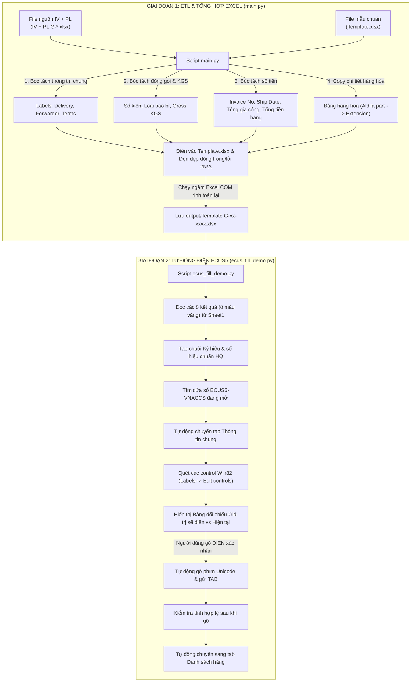

# TÀI LIỆU DỰ ÁN TỰ ĐỘNG HÓA XỬ LÝ CHỨNG TỪ & ĐIỀN TỜ KHAI HẢI QUAN ECUS5-VNACCS

---

## 1. TỔNG QUAN DỰ ÁN (PROJECT OVERVIEW)

Dự án này là một giải pháp tự động hóa quy trình nghiệp vụ (RPA - Robotic Process Automation kết hợp ETL dữ liệu) dành cho phòng Xuất Nhập Khẩu (XNK) / Logistics. Dự án được thiết kế đặc thù cho doanh nghiệp sản xuất chế xuất (cụ thể: **Công Ty TNHH ALDILA COMPOSITE PRODUCTS** tại KCN Việt Nam - Singapore, chuyên sản xuất và xuất khẩu sản phẩm composite / cán gậy golf).

Hệ thống giải quyết bài toán:
1. **Xử lý chứng từ xuất khẩu**: Tự động đọc và bóc tách dữ liệu từ các bộ chứng từ hỗn hợp Invoice & Packing List (`IV + PL G-*.xlsx`), chuẩn hóa và tổng hợp vào file mẫu trung gian (`Template.xlsx`).
2. **Khai báo hải quan điện tử**: Tự động kết nối tới phần mềm **ECUS5-VNACCS** đang chạy trên máy tính Windows, tự động định vị các ô nhập liệu của tờ khai xuất khẩu và điền chính xác toàn bộ thông tin chỉ với 1 thao tác xác nhận an toàn.

---

## 2. KIẾN TRÚC & QUY TRÌNH HOẠT ĐỘNG (SYSTEM ARCHITECTURE)

Quy trình tự động hóa được chia làm 2 giai đoạn độc lập nhằm đảm bảo tính an toàn và minh bạch tuyệt đối:



---

## 3. CẤU TRÚC THƯ MỤC VÀ TỪNG FILE TRONG DỰ ÁN

| Đường dẫn / Tên file | Loại | Chức năng & Mô tả |
| :--- | :--- | :--- |
| `app.py` | Python GUI App | **Ứng dụng Giao diện Desktop hoàn chỉnh**: Sử dụng CustomTkinter. Cho phép **chọn upload 1 hoặc nhiều file cùng lúc** (hoặc chọn cả folder), tự động bóc tách và **hỏi người dùng vị trí lưu file nén .ZIP** (bên trong chứa sẵn folder kết quả rất nhẹ và gọn). Tab 2 hỗ trợ xem trước 12 trường và tự động điền/mô phỏng ECUS5. |
| `ChayApp.command` | Shell Script | File thực thi nhấp đúp chạy ngay ứng dụng trên macOS không cần gõ lệnh. |
| `main.py` | Python Script | **Core Module Bước 1**: Đọc toàn bộ file `IV + PL G-*.xlsx`, bóc tách dữ liệu thông minh, copy bảng chi tiết hàng hóa, dọn dẹp hàng thừa, chạy Excel recalculation và lưu file ra thư mục `output/`. |
| `ecus_fill_demo.py` | Python Script | **Core Module Bước 2 (Hỗ trợ cả Windows & Mac)**: Đọc file từ `output/`. Trên **Windows**, tự động tìm cửa sổ ECUS5, chuyển tab, điền 12 trường vào tab "Thông tin chung" và chuyển sang tab "Danh sách hàng". Trên **macOS**, tự động chạy **Chế độ Mô phỏng & Kiểm thử (Simulation Mode)**: Hiển thị bảng đối chiếu 12 trường, tự động copy chuỗi "Ký hiệu & số hiệu" vào Clipboard, và mô phỏng luồng điền dữ liệu. |
| `Template.xlsx` | Excel File | File mẫu chuẩn đã cài đặt sẵn định dạng, công thức quy đổi mã đơn vị (BOX -> BX, PLASTIC PALLET -> PP...), tính toán thuế và bảng danh sách hàng khai báo. |
| `input/` | Thư mục | Thư mục chứa các file chứng từ nguồn thực tế (`IV + PL G-*.xlsx`). |
| `output/` | Thư mục | Nơi lưu trữ các file Excel thành phẩm sau khi `main.py` chạy xong (`Template G-26-1108.xlsx`, `Template G-26-1193.xlsx`). |
| `ecus_win32_danhsachhang.txt` | Text Report | Kết quả trích xuất cấu trúc control của màn hình ECUS5 ở tab "Danh sách hàng" (dùng để phát triển tính năng nhập danh sách hàng sau này). |
| `ecus_win32_themdanhsachhang.txt` | Text Report | Kết quả trích xuất cấu trúc control của popup/màn hình thêm mới hàng hóa chi tiết trong ECUS5. |

---


## 4. CHI TIẾT CÁC TÍNH NĂNG VÀ NGUYÊN LÝ KỸ THUẬT

### 4.1. Module Xử lý Dữ liệu Excel (`main.py`)

- **Nhận diện và xử lý ô bị gộp (Merged Cells)**: Hàm `real_cell()` tự động phát hiện ô nằm trong vùng merge và trỏ về đúng ô góc trên bên trái (`top-left cell`) nơi Excel lưu trữ giá trị thật.
- **Tự động quét nhãn linh hoạt (Fuzzy / Regex Matching)**:
  - Quét tìm nhãn thông tin chung: `Mode of Delivery:`, `Forwarder/Consolidator:`, `Terms of sale:`, `Ship via:`, `Container Stuffing Location:`.
  - Hỗ trợ cấu hình riêng cho nhãn dị biệt (ví dụ `Terms of sale:` nhãn có thể nằm ở cột bất kỳ trước cột K, quét giá trị từ cột K đến Q).
- **Phân tách thông minh giữa Sheet Invoice và Packing List**:
  - Dùng marker `invoice no` để xác định sheet hóa đơn (lấy bảng hàng hóa, tiền bạc, invoice date).
  - Dùng marker `packing list no` để xác định sheet đóng gói (lấy số kiện, loại đóng gói, Gross KGS).
- **Trích xuất quy cách đóng gói (Packaging & Gross Weight)**:
  - Nhận diện các từ khóa đóng gói: `box`, `bundle`, `package`, `plastic pallet`, `pallet consists`, `pallet size`.
  - Tự động lấy số lượng kiện ở ô số liền trước.
  - Tìm dòng `TOTAL WEIGHT`, đọc trọng lượng KGS.
  - **Cơ chế kiểm tra chéo (Sanity Check)**: Tự tính tỷ lệ $LBS / KGS$ và cảnh báo nếu tỷ lệ lệch khỏi mức chuẩn xấp xỉ $2.2046$.
- **Trích xuất và kiểm tra tiền tệ, tổng giá trị**:
  - Đọc `processing_total` (Tổng phí gia công) và `custom_total` (Tổng giá trị khai báo hải quan).
  - Tự động tính tổng cộng các dòng hàng thực tế và đối chiếu xem có khớp với ô `TOTAL` trong file gốc hay không. Cảnh báo ngay nếu phát hiện lệch số liệu.
- **Sao chép bảng chi tiết hàng hóa (Items Table Copy)**:
  - Định vị bảng hàng bắt đầu từ tiêu đề `Aldila part` (cột I) đến cột `Extension` (cột Q).
  - Lọc bỏ hoàn toàn các dòng trống, dòng ghi chú (như `GOLF SHAFTS ****`).
  - Dán dữ liệu liên tục vào `Sheet2` của template từ ô `A2`.
- **Dọn dẹp hàng rào công thức thừa (`trim_extra_rows`)**:
  - Tự động ẩn (`hide`) hoặc xóa (`delete`) các dòng công thức dư thừa ở `Sheet2` và `Sheet3` để triệt tiêu các lỗi hiển thị `#N/A`.
- **Excel Background COM Recalculation**:
  - Khởi tạo tiến trình `Excel.Application` ẩn qua Win32 COM (`win32com.client`), thực thi lệnh `excel.CalculateFull()` để cập nhật toàn bộ công thức trong workbook và lưu lại.

---

### 4.2. Module Tự động Điền ECUS5 (`ecus_fill_demo.py`)

- **Không cần cài đặt thư viện nặng**: Sử dụng trực tiếp `ctypes` để gọi Win32 API gốc của Windows, giúp script chạy mượt, nhẹ và không phát sinh lỗi tương thích phiên bản.
- **Tự động chuyển Tab thông minh (`go_to_tab`)**:
  - Tìm control `SysTabControl32` chính của cửa sổ tờ khai.
  - Cấp phát bộ nhớ tạm trong không gian địa chỉ của tiến trình ECUS bằng `VirtualAllocEx` và đọc vị trí tab bằng `ReadProcessMemory` qua thông điệp `TCM_GETITEMRECT`.
  - Gửi thông điệp chuột `WM_LBUTTONDOWN` / `WM_LBUTTONUP` tới tọa độ tab để chuyển tab mà không cướp hoặc di chuyển con trỏ chuột của người dùng.
- **Định vị ô nhập liệu động (Dynamic Visual Relative Locating)**:
  - Thay vì hard-code tọa độ màn hình (dễ bị sai khi thay đổi độ phân giải màn hình hoặc kích thước cửa sổ), tool quét tất cả các nhãn `STATIC` và tìm ô `EDIT` hiển thị cùng dòng ngay bên phải của nhãn tương ứng.
- **12 Trường thông tin được tự động điền vào Tab "Thông tin chung"**:
  1. **Số hóa đơn**: Lấy từ ô `B21`.
  2. **Ngày phát hành hóa đơn**: Lấy từ ô `B22` (định dạng `dd/mm/yyyy`).
  3. **Điều kiện giá hóa đơn**: Lấy từ ô `C11` (tự trích xuất mã điều kiện như `FOB`).
  4. **Mã đồng tiền của hóa đơn**: Lấy từ ô `C12` (ví dụ `USD`).
  5. **Tổng trị giá hóa đơn**: Lấy từ ô `B27` (định dạng tiền tệ chuẩn có dấu phẩy `,`).
  6. **Trị giá tính thuế**: Lấy từ ô `B27`.
  7. **Số lượng kiện**: Lấy từ ô `D16` (làm tròn số nguyên).
  8. **Đơn vị kiện**: Lấy từ ô `D17` (mã đơn vị do template tính: `PP`, `BX`...).
  9. **Tổng trọng lượng hàng (Gross KGS)**: Lấy từ ô `D18` (lấy tối đa 3 chữ số thập phân).
  10. **Ký hiệu và số hiệu**: Tự động sinh chuỗi quy chuẩn hải quan:
      `PTTT: TT, TGTT = TGGC =   {tggc} {cur},TG NVL = {tgnvl} {cur}, NNH: {nnh}`
      (trong đó `tggc` là tổng gia công ô B25, `tgnvl` là tổng NVL ô B26, `cur` là đồng tiền C12, `nnh` là tên người nhận hàng C13).
  11. **Ngày khởi hành vận chuyển**: Điền ngày hóa đơn (hỗ trợ cả nhãn sai chính tả `khời hành` trong ECUS).
  12. **Ngày đến địa điểm đích bảo thuế**: Điền ngày hóa đơn vào ô ngày thứ 3 của cụm địa điểm đích.
- **An toàn tuyệt đối (Safety Guardrails)**:
  - Trước khi điền, tool in ra bảng so sánh chi tiết: Tên trường | Giá trị sẽ điền | Giá trị hiện tại trên ECUS.
  - Bắt buộc người dùng gõ chữ `DIEN` mới thực hiện nhập liệu.
  - Đếm ngược 5 giây để người dùng chuẩn bị.
  - Kiểm tra `AttachThreadInput` và `SetFocus` trước khi gõ; nếu không focus được ô sẽ tự động bỏ qua để không gõ nhầm vị trí.
  - Gõ từng ký tự Unicode và gửi phím TAB để kích hoạt sự kiện validation của ECUS.
  - Đọc lại giá trị vừa gõ để báo trạng thái `OK` hoặc `KHAC`.
  - **TUYỆT ĐỐI KHÔNG BẤM GHI / GỬI**: Người dùng toàn quyền kiểm tra lại bằng mắt, nhập nốt các thông tin phụ (như booking, ngày giờ tàu chạy) trước khi bấm lưu tờ khai.
  - Tự động chuyển người dùng sang tab "Danh sách hàng" sau khi hoàn tất.

---

## 5. BẢNG ÁNH XẠ DỮ LIỆU (DATA MAPPING MATRIX)

| Trường thông tin | Nguồn bóc tách (`IV + PL G-*.xlsx`) | Ô đích trên `Template.xlsx` | Vị trí điền trên `ECUS5` (Tab Thông tin chung) | Định dạng điền |
| :--- | :--- | :--- | :--- | :--- |
| **Số Invoice** | Sheet IV, dưới nhãn `INVOICE NO.` | `Sheet1!B21` | Nhãn `Số hóa đơn:` | Text nguyên bản (VD: `G-26-1108`) |
| **Ngày Ship / Invoice** | Sheet IV, bên phải nhãn `Ship Date` | `Sheet1!B22` | Nhãn `Ngày phát hành:`, `Ngày khởi hành VC:`, `Địa điểm đích...` | `dd/mm/yyyy` |
| **Điều kiện giá (Incoterms)** | Sheet IV/PL, nhãn `Terms of sale:` | `Sheet1!C11` | Nhãn `Điều kiện giá hóa đơn:` | Lấy từ đầu viết hoa (VD: `FOB`) |
| **Đồng tiền** | Sheet IV, bên phải nhãn `Currency` | `Sheet1!C12` | Nhãn `Mã đồng tiền của hóa đơn:` | Text (VD: `USD`) |
| **Tên người nhận (Ship to)** | Sheet IV, dưới `Ship to Name & Address` | `Sheet1!C13` | Cấu thành chuỗi `Ký hiệu và số hiệu` | Text (VD: `ACUSHNET EUROPE LTD.`) |
| **Số lượng kiện** | Sheet PL, số bên trái từ khóa bao bì | `Sheet1!B16` -> Công thức ra `D16` | Nhãn `Số lượng kiện:` (ô số lượng) | Số nguyên (VD: `9`) |
| **Loại bao bì / Đơn vị** | Sheet PL, từ khóa `box`/`pallet`... | `Sheet1!B17` -> Template đổi mã `D17` | Nhãn `Số lượng kiện:` (ô đơn vị) | Mã đơn vị chuẩn HQ (VD: `BX`, `PP`) |
| **Trọng lượng Gross** | Sheet PL, dòng `TOTAL WEIGHT` (cột KGS) | `Sheet1!B18` -> Công thức ra `D18` | Nhãn `Tổng trọng lượng hàng (Gross):` | Số thập phân (VD: `31.5`) |
| **Tổng gia công (TGGC)** | Sheet IV, dòng `TOTAL`, cột `Processing Fee` | `Sheet1!B25` | Cấu thành chuỗi `Ký hiệu và số hiệu` | Số thập phân (VD: `154.80`) |
| **Tổng tiền hàng (TG NVL)** | Sheet IV, dòng `TOTAL`, cột `Custom amount` | `Sheet1!B26` / `B27` | Cấu thành chuỗi `Ký hiệu và số hiệu` | Số thập phân (VD: `272.20`) |
| **Tổng trị giá hóa đơn** | Sheet IV, dòng `TOTAL`, cột tổng tiền | `Sheet1!B27` | Nhãn `Tổng trị giá hóa đơn:` & `Trị giá tính thuế:` | Định dạng tiền (VD: `272.20`) |
| **Bảng chi tiết hàng hóa** | Sheet IV, dòng dưới `Aldila part` đến `TOTAL` | Dán vào `Sheet2!A2` đến hết | Chuyển sang Tab `Danh sách hàng` để xử lý tiếp | Giữ nguyên dữ liệu các dòng hàng |

---

## 6. HƯỚNG DẪN CÀI ĐẶT VÀ SỬ DỤNG

### 6.1. Yêu cầu môi trường
- Hệ điều hành: **Windows 10 / 11** (nơi cài đặt phần mềm ECUS5-VNACCS và Microsoft Excel).
- Python: **Python 3.8+**.
- Thư viện cần thiết:
  ```bash
  pip install openpyxl pywin32
  ```

### 6.2. Các bước vận hành thực tế

#### Bước 1: Chuẩn bị file và trích xuất Excel
1. Copy các file chứng từ cần khai báo vào thư mục làm việc (mặc định là `D:\test\`, tên file dạng `IV + PL G-*.xlsx`).
2. Mở Command Prompt hoặc Terminal, chạy lệnh:
   ```bash
   python main.py
   ```
3. Script sẽ đọc toàn bộ file nguồn, thực hiện kiểm tra chéo (sanity checks), điền dữ liệu vào `Template.xlsx`, nhờ Excel tính toán lại và xuất file vào `D:\test\output\Template G-xx-xxxx.xlsx`.

#### Bước 2: Tự động điền dữ liệu vào tờ khai ECUS5
1. Mở phần mềm **ECUS5-VNACCS**.
2. Mở một tờ khai xuất khẩu mới (hoặc tờ khai đang sửa dở dang), đảm bảo các ô không bị khóa.
3. Chạy lệnh:
   ```bash
   python ecus_fill_demo.py
   ```
4. Chọn số thứ tự file template trong danh sách file hiển thị từ thư mục `output/`.
5. Script sẽ tự động chuyển ECUS sang tab "Thông tin chung" và hiển thị bảng so sánh các giá trị sẽ điền.
6. Kiểm tra lại thông tin trên màn hình console:
   - Nếu đồng ý: Gõ chữ `DIEN` rồi nhấn `Enter`.
   - Nếu không đồng ý: Nhấn `Enter` để hủy.
7. Sau khi gõ `DIEN`, chờ 5 giây không chạm vào chuột/bàn phím để script tự động gõ dữ liệu vào các ô.
8. Khi hoàn tất, script sẽ tự động chuyển sang tab "Danh sách hàng".
9. Nhân viên kiểm tra lại bằng mắt, nhập các thông tin booking / ngày tàu chạy còn thiếu, rồi bấm **Ghi** (Lưu) trên ECUS5.

---

## 7. CÁC CẢNH BÁO VÀ LƯU Ý KỸ THUẬT QUAN TRỌNG

1. **Công thức Excel bị rỗng (Cached Values)**:
   - File Excel nguồn xuất từ các phần mềm ERP đôi khi chỉ lưu chuỗi công thức mà chưa có kết quả tính sẵn. `main.py` có cơ chế tự động phát hiện và cảnh báo: *"Dong nay co cong thuc/gia tri trong file goc -> Mo file nguon bang Excel, bam Ctrl+S roi chay lai"*.
2. **Quyền Administrator trên Windows**:
   - Nếu ECUS5 được khởi chạy dưới quyền Administrator (`Run as Administrator`), script Python cũng phải được mở bằng Terminal có quyền Administrator để các hàm `VirtualAllocEx` và `AttachThreadInput` hoạt động được.
3. **Độ ổn định khi điền dữ liệu tự động**:
   - Trong quá trình 5 giây sau khi xác nhận `DIEN`, người dùng tuyệt đối không click chuột lung tung hoặc chuyển sang cửa sổ khác, tránh làm mất focus của ô nhập liệu trên ECUS.
